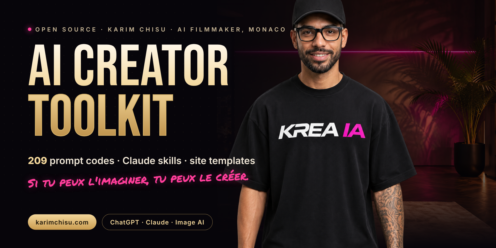
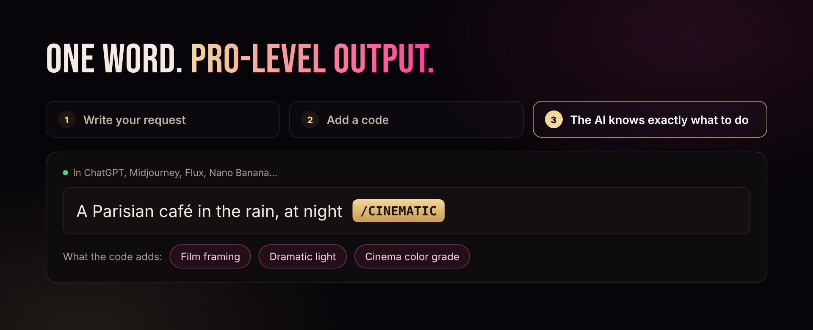
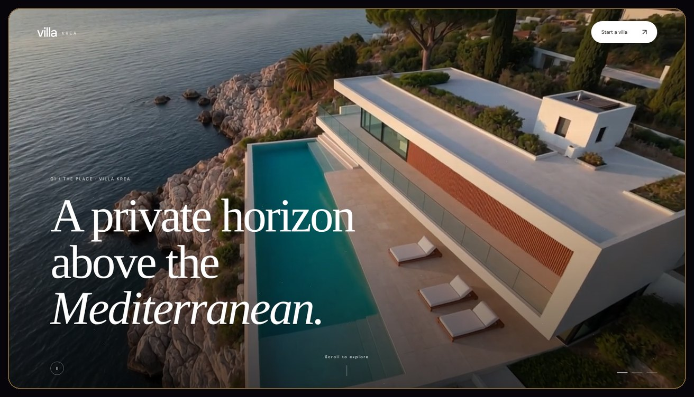
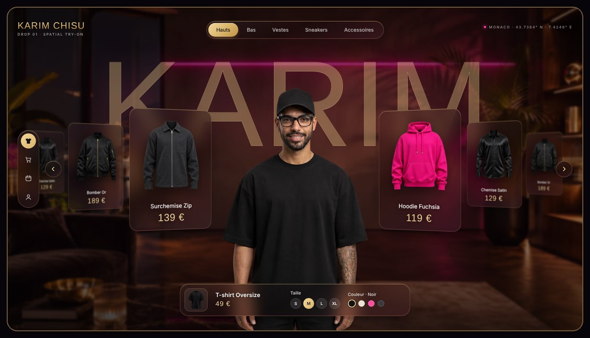
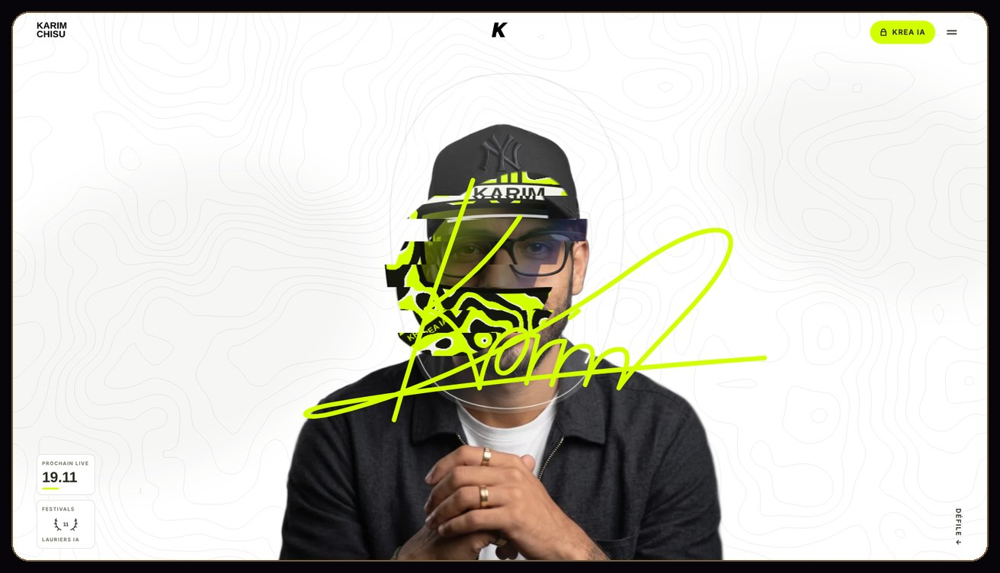
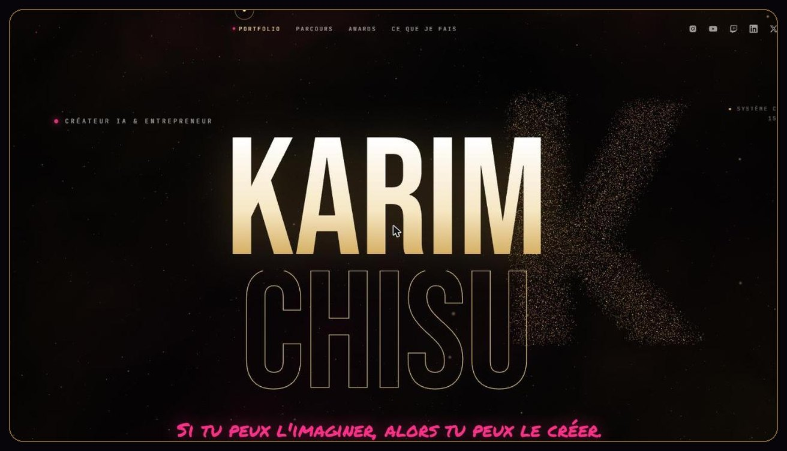
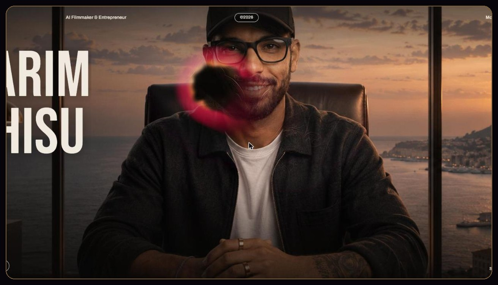
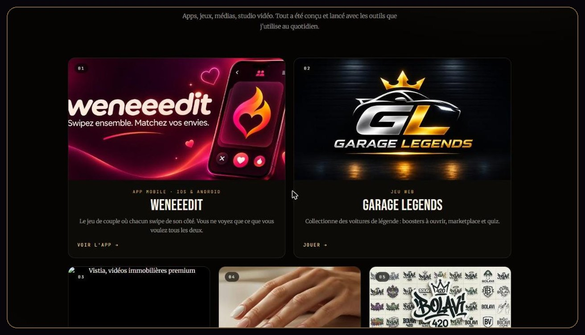
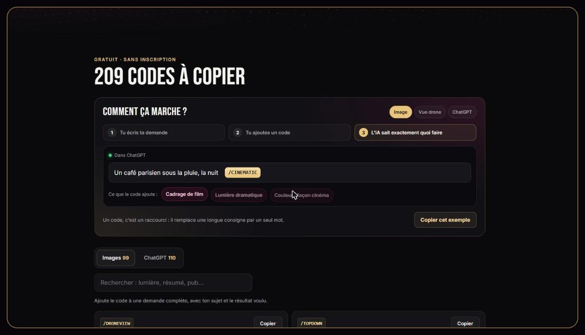
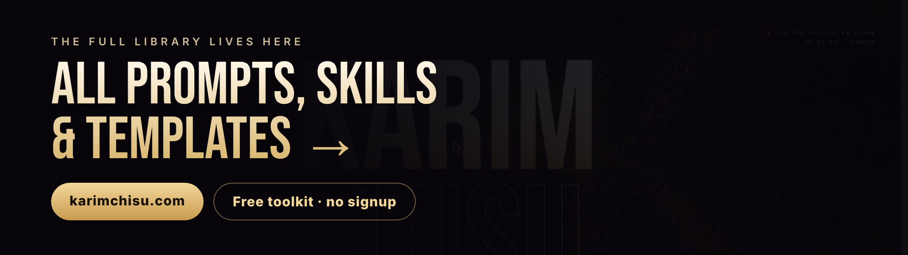

<a href="https://karimchisu.com/?utm_source=github&utm_medium=banner"></a>

<p align="center">
  <a href="https://karimchisu.com/?utm_source=github&utm_medium=badge"></a>
  
  
  
</p>

<h3 align="center">The prompts, Claude skills and site templates I use every day to create with AI.<br>Copy, paste, ship.</h3>

<p align="center"><b>⭐ Star the repo</b> to keep it in your toolbox · <b><a href="#-en-français">Version française ↓</a></b></p>

---

## What's inside

| | | |
|---|---|---|
| 🎯 **[209 prompt codes](#-209-prompt-codes)** | One-word shortcuts that replace a long instruction. 99 for image AI, 110 for ChatGPT / Claude. | [Image codes](codes/image-codes.md) · [ChatGPT codes](codes/chatgpt-codes.md) · [JSON](codes/codes.json) |
| ✍️ **[Business prompts](#%EF%B8%8F-business-prompts)** | Battle-tested prompts to build an offer, find clients and write like a human. | [3 free prompts](prompts/) |
| 🧠 **[Claude skills](#-claude-skills)** | Full workflows Claude follows step by step. | [KreaSite](skills/kreasite/SKILL.md) |
| 🏗️ **[Templates](#%EF%B8%8F-templates)** | Production-ready sites you can fork and rebrand. | [Villa landing](templates/villa-landing/) |

---

## 🎯 209 prompt codes



Write your request, add a code at the end. The AI gets the full instruction behind it.

```text
A perfume bottle on black marble /HEROSHOT /RIMLIGHT /LUXURY
Explain how a Shopify store makes money /ELI5 /TABLE /NO-FLUFF
```

**A taste of the image codes** (Midjourney, Flux, Nano Banana, GPT-Image…)

| Code | What it does |
|---|---|
| `/CINEMATIC` | Framing, light, depth and color grading inspired by cinema. |
| `/HEROSHOT` | Turns the product into an iconic ad image with dramatic lighting. |
| `/EXPLODEVIEW` | Separates the product parts to show how it is built. |
| `/VOLUMETRIC` | Visible light beams through haze, dust or smoke. |
| `/THUMBNAIL` | Thumbnail with a dominant subject, strong contrast and room for text. |
| `/UGCAD` | Native-looking, simple and believable ad in a user-generated style. |

**A taste of the ChatGPT / Claude codes**

| Code | What it does |
|---|---|
| `/PRE-MORTEM` | Assumes the project failed and looks for the likely causes upfront. |
| `/RED TEAM` | Actively attacks a plan's weaknesses like an opponent. |
| `/PARETO` | Finds the 20% of actions likely to drive most of the result. |
| `/HOOKS` | Several hooks designed to stop the scroll. |
| `/CFO MODE` | Frames a decision through margin, cash, costs, ROI and financial risk. |
| `/SELF-CHECK` | Final check: consistency, gaps, math and constraints. |

👉 **[All 99 image codes](codes/image-codes.md)** · **[All 110 ChatGPT codes](codes/chatgpt-codes.md)** · **[codes.json](codes/codes.json)** for your own tools. Every code comes in English and French.

---

## ✍️ Business prompts

Fill the `[BRACKETS]`, paste into ChatGPT, Claude or Gemini. English version + French original.

| Prompt | What you get | |
|---|---|---|
| **Offer Architect** | One simple offer you can sell, with a 7-day validation test. | [Open →](prompts/offer-architect.md) |
| **Client Finder** | Your ideal client, where to find them, 10 search queries and outreach messages. | [Open →](prompts/client-finder.md) |
| **Human Writer** | AI text that sounds like you, not like an assistant. | [Open →](prompts/human-writer.md) |
| 🔒 Business Coach Pro | Finds the one bottleneck limiting your business right now. | [karimchisu.com](https://karimchisu.com/?utm_source=github&utm_medium=prompts) |
| 🔒 Lead List Builder | Verified prospect list with buying signals and contact angles. | [karimchisu.com](https://karimchisu.com/?utm_source=github&utm_medium=prompts) |
| 🔒 Automation Architect | What to automate, what to keep human, and the workflow to build. | [karimchisu.com](https://karimchisu.com/?utm_source=github&utm_medium=prompts) |
| 🔒 Content Team Orchestrator | Researcher → Strategist → Writer → Repurposer, in the right order. | [karimchisu.com](https://karimchisu.com/?utm_source=github&utm_medium=prompts) |

---

## 🧠 Claude skills

**KreaSite** (free): show Claude a website that impresses you, it rebuilds one at the same level in your brand. Three.js, WebGL, scroll camera, motion, tested in a headless browser before delivery.

→ [Read the skill and install it](skills/)

| Also in the library | |
|---|---|
| 🔒 **Dan Koe Style** | Voice-over → minimalist 9:16 motion-design video, rendered to a real file. |
| 🔒 **Signature Edit** | Raw footage → premium luxury-street edit (black, gold, fuchsia), exported. |

---

## 🏗️ Templates

<a href="templates/villa-landing/"></a>

**[Villa landing](templates/villa-landing/)** (free): luxury real-estate page with Three.js depth, a scroll story in chapters, gallery and inquiry form. Fork it, swap the images, deploy.

**More builds from the same workflow** (not open source, to show what's possible):

<table>
<tr>
<td width="50%"><br><b>Spatial Try-On</b> · virtual fitting room for a clothing drop</td>
<td width="50%"><br><b>Personal brand site</b> · topographic hero, live dates, awards</td>
</tr>
</table>

---

## Built with this stack

Sites, apps and games I designed and shipped with the same tools and workflow.

<table>
<tr>
<td width="50%"><a href="https://karimchisu.com/?utm_source=github&utm_medium=gallery"></a><br><b>karimchisu.com</b> · personal site</td>
<td width="50%"><a href="https://www.sat0oshi.com/portfolio?utm_source=github&utm_medium=gallery"></a><br><b>Portfolio</b> · AI films, sites, ads, motion</td>
</tr>
<tr>
<td width="50%"><a href="https://www.sat0oshi.com/app?utm_source=github&utm_medium=gallery"></a><br><b>Apps & games</b> · weneeedit (iOS & Android), Garage Legends</td>
<td width="50%"><a href="https://www.sat0oshi.com/toolkit?utm_source=github&utm_medium=gallery"></a><br><b>Free toolkit</b> · the interactive version of these codes</td>
</tr>
</table>

---

## About

I'm **Karim Chisu**, AI filmmaker and entrepreneur based in Monaco. My AI films have been selected and awarded at international AI film festivals (Amsterdam, Dubai, Cannes/WAICF, Miami, Runway AIFF). I've trained 1,600+ students to create with AI, and I build apps, games, sites and ads with the same tools I share here.

<a href="https://karimchisu.com/?utm_source=github&utm_medium=cta"></a>

---

## 🇫🇷 En français

**La boîte à outils IA que j'utilise tous les jours : prompts, skills Claude et templates de sites.** Tout est en anglais et en français.

- **[209 codes de prompt](codes/image-codes.md)** : des raccourcis d'un mot qui remplacent une longue consigne. 99 pour l'image, 110 pour ChatGPT. Tu écris ta demande, tu ajoutes le code à la fin.
- **[3 prompts business](prompts/)** : Offer Architect, Client Finder, Human Writer. Version originale en français dans chaque fichier.
- **[Skill KreaSite](skills/)** : montre à Claude un site qui t'impressionne, il t'en construit un du même niveau dans ta DA.
- **[Template Villa](templates/villa-landing/)** : landing immobilier de luxe en Three.js, prête à adapter.

La bibliothèque complète (tous les prompts, les autres skills, les templates et la formation) est sur **[karimchisu.com](https://karimchisu.com/?utm_source=github&utm_medium=fr)**.

Si ça t'aide, **laisse une ⭐**, c'est ce qui fait connaître le repo.

---

<p align="center"><sub>MIT License · Made in Monaco by <a href="https://karimchisu.com/?utm_source=github&utm_medium=footer">Karim Chisu</a></sub></p>
