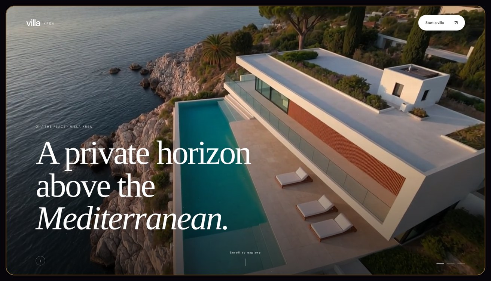

# Villa landing page template

A luxury real-estate landing page with Three.js depth effects, a scroll story in chapters (place → construction → keys), a gallery and an inquiry form. Desktop and mobile hero videos included.



## Run it locally

Three.js modules don't load from a double-click, so start a tiny local server from this folder:

```bash
python -m http.server 8000 --bind 127.0.0.1
```

Then open http://localhost:8000.

## Make it yours

- Text and brand: edit `index.html` (search for `VILLA KREA`).
- Images and videos: replace the files in `assets/`, keep the same names or update the paths.
- The form builds a downloadable inquiry draft. It does not send email: plug in your own form service if you need it.
- Needs WebGL 2 for the 3D effects. A plain gallery shows up without it.

## Deploy

Upload `index.html` and the `assets/` folder to any static host: Cloudflare Pages, Netlify drag & drop, GitHub Pages.

---

More templates and the full KreaSite workflow: **[karimchisu.com](https://karimchisu.com/?utm_source=github&utm_medium=template)**
